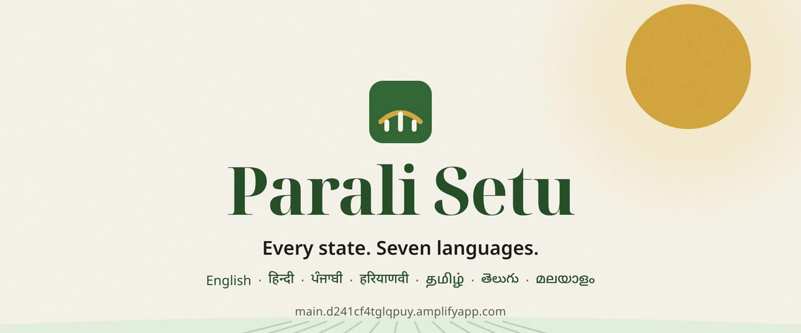
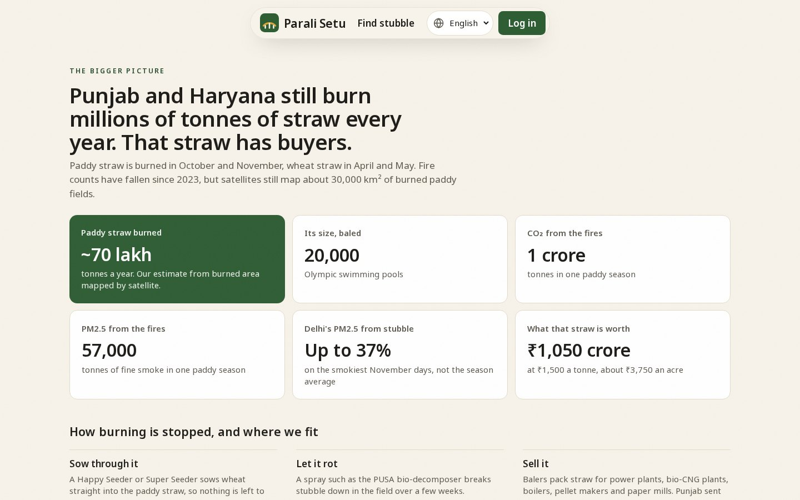
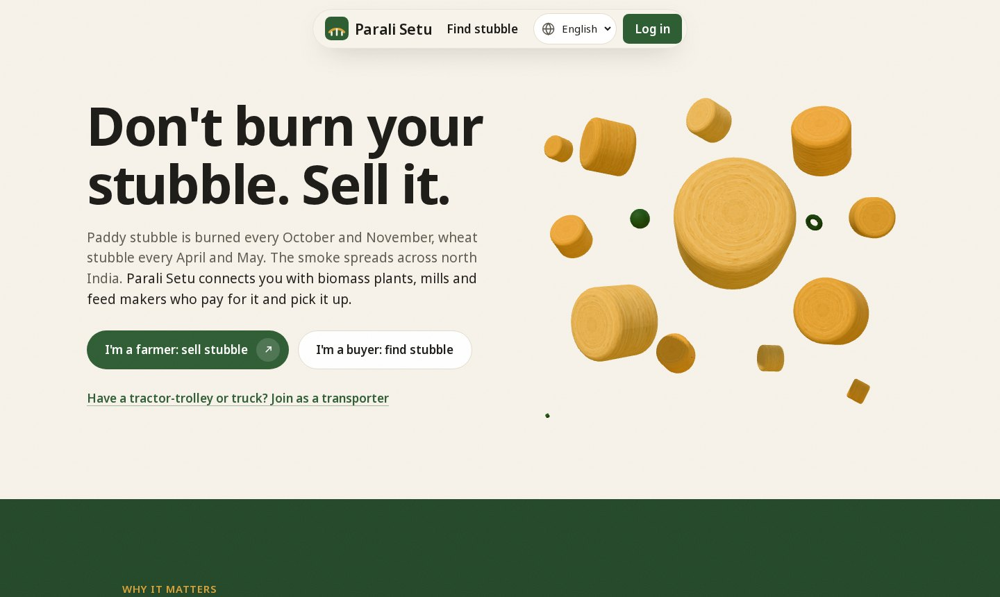
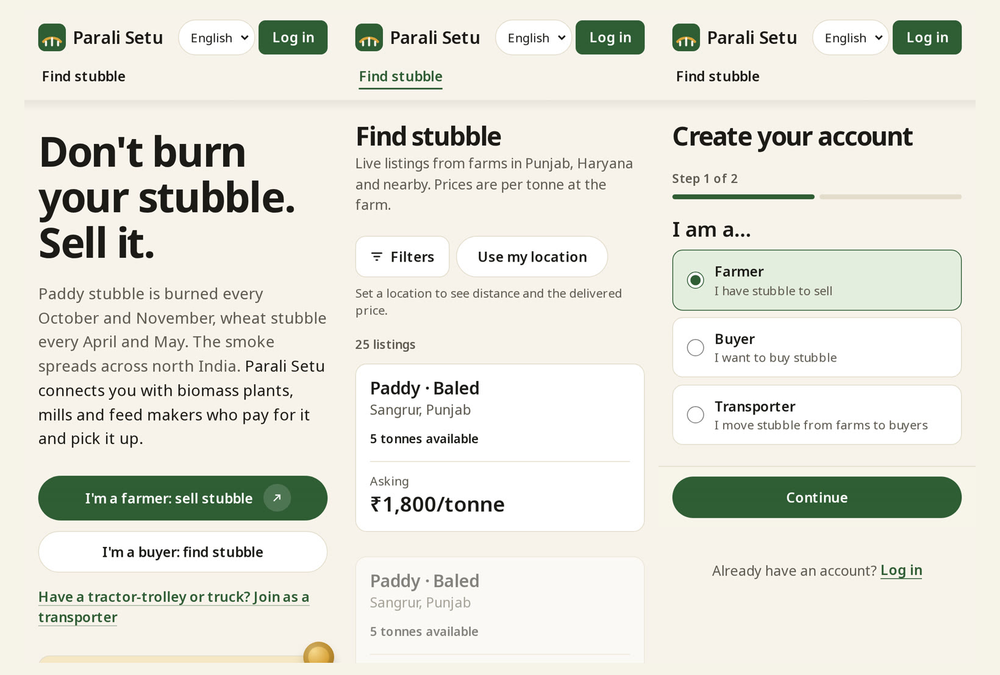
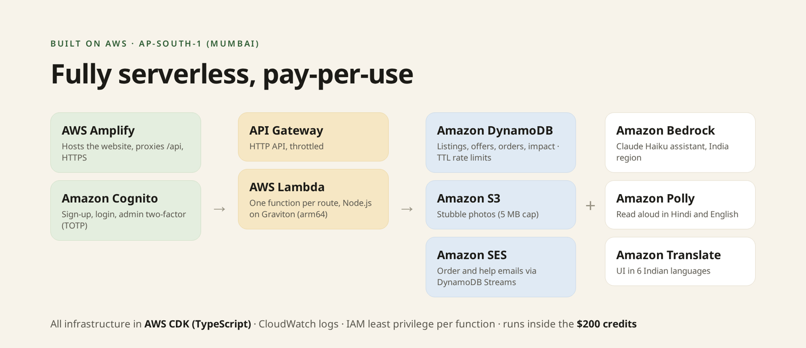

<p align="center">
  
</p>

# Parali Setu

**Sell stubble. Stop burning.** A marketplace that connects farmers who have crop stubble with the buyers who want it and the transporters who can move it.

**Live site:** https://main.d241cf4tglqpuy.amplifyapp.com

Built for the WeMakeDevs × AWS Bharat Builds Tour, Environmental Hacks, Track 01 (Air).

## The problem

After the paddy harvest in October and November, and again after wheat in April and May, farmers in Punjab and Haryana burn their stubble (*parali*). They don't want to. Clearing the field costs money, and the next crop has to go in within weeks. By our estimate from satellite-mapped burned area, about 70 lakh tonnes of paddy straw is burned every year. On the smokiest days, stubble smoke has made up to 37% of Delhi's PM2.5.

The straw has buyers: biomass and bio-CNG plants, paper mills, boilers, cattle feed makers and mushroom growers. What's missing is a way for them to find each other at a fair price, and someone to haul it. Parali Setu ("stubble bridge") is that link.



## How it works

| Who | What they do |
|---|---|
| **Farmer** | Lists stubble in four short steps: crop, tonnes, location, price. A fair price band for the region shows next to the price field. Accepts, counters or rejects offers. |
| **Buyer** | Searches by state, crop, price and distance. Sees one **delivered price per tonne** (stubble plus transport), locked at the moment of the offer. Makes an offer and pays when the stubble arrives. |
| **Transporter** | Picks pickup jobs from a board that shows the route, distance and earnings, then marks them picked up and delivered. |
| **Admin** | Approves listings, verifies people, sees every order. Signs in on a separate hidden page with a two-factor code. |

Negotiation has one counter round, so a deal either closes or doesn't. Every delivered tonne adds to a public impact counter on the home page: tonnes kept out of the fire, CO₂ and PM2.5 avoided, and rupees paid to farmers.



## Made for the people who'll use it

- **All of India, seven languages.** Every state and union territory, in English, Hindi, Punjabi, Haryanvi, Tamil, Telugu and Malayalam. Outside English, headings and buttons keep a small English line underneath, so a family member or a helper can follow along.
- **Built for cheap phones.** Short paged steps, big buttons and no long scrolling. The Three.js hero and scroll animations only load on laptops with a fine pointer. It can be installed from the browser, and Android and iOS app shells are included (see [docs/MOBILE.md](docs/MOBILE.md)).
- **An assistant that understands Hinglish.** Amazon Bedrock answers questions about prices and the app, and Amazon Polly reads the answer aloud in Hindi or English.



## Safe by design

- Login uses **httpOnly cookies**. No token is ever stored where page scripts can read it. State-changing requests carry a CSRF header, and a strict content security policy limits what the page can load.
- **Admin accounts need an authenticator-app code** every time. They can't be created from the public signup, and the admin page isn't linked anywhere public.
- **Rate limits** per user on every route (5 login attempts a minute), and a hard daily cap on AI calls to keep the bill predictable.
- **Least-privilege IAM** per Lambda, and ids are validated before they reach any database key.
- **An 18+ check** on signup, with a route for a parent or guardian to contact the team. Consent is recorded with the account, phone numbers are masked, and users can delete their account.
- Privacy, terms, refund, shipping and contact pages are included.

How login works in detail: [docs/AUTH.md](docs/AUTH.md).

## Architecture

Fully serverless in `ap-south-1` (Mumbai), with all infrastructure written in AWS CDK (TypeScript).



| Service | What it does here |
|---|---|
| Amplify Hosting | Serves the static Next.js site and proxies `/api` so cookies are first-party |
| Cognito | Sign-up, email verification, login, TOTP for admins |
| API Gateway and Lambda | One Node.js function per route, on arm64 |
| DynamoDB | Single table for users, listings, offers, orders and impact; transactions prevent double-accepts; TTL clears rate-limit counters; Streams trigger emails |
| S3 | Listing photos through a size-capped presigned POST |
| SES | Order and help emails |
| Bedrock | The assistant (Claude Haiku, India inference profile) |
| Polly | Read-aloud |
| Translate | First-pass UI translations, then reviewed by hand |
| CloudWatch | Logs |

More detail, including table keys and routes, is in [docs/ARCHITECTURE.md](docs/ARCHITECTURE.md).

## Run it locally

You don't need an AWS account. You need Node 20 and Java 17 (for DynamoDB Local).

```bash
npm install
curl -sL https://d1ni2b6xgvw0s0.cloudfront.net/v2.x/dynamodb_local_latest.tar.gz | tar xz -C .dynamodb   # once
npm run dev:db            # DynamoDB Local on :8765
npm run dev:api           # the real Lambda handlers on http://localhost:4000 (AI replies are mocked)
npm run seed:local        # sample listings only, no accounts
npm -w frontend run dev   # http://localhost:3000
```

Sign up in the app to create accounts. Locally, signup is confirmed automatically and there's no email. To make a local admin, sign up first and then run `npx tsx scripts/make-admin.ts --local you@example.com`.

Checks:

```bash
npm test                          # unit tests
npx tsx scripts/smoke-local.ts    # end-to-end flow against the local API
npm run synth                     # builds the CloudFormation templates
```

## Deploy

The complete, ordered checklist is in [docs/DEPLOY_CHECKLIST.md](docs/DEPLOY_CHECKLIST.md). In short:

```bash
aws configure                                    # region ap-south-1
npx -w infra cdk bootstrap aws://<ACCOUNT_ID>/ap-south-1
npm run deploy                                   # all stacks, writes cdk-outputs.json
npm run amplify-proxy -- <amplifyAppId>          # /api/* to API Gateway, with cookie forwarding
npm run verify-deploy -- https://main.<appId>.amplifyapp.com
```

`verify-deploy` prints a pass or fail table: stacks, API, database reads and writes, login cookies through the proxy, security headers, and that no source maps are served. Amplify builds the site from `amplify.yml`; the environment variables it needs are in the checklist.

## Where the numbers come from

- **CO₂:** about 1.42 tonnes per tonne of residue burnt (Jain et al. 2014, *Aerosol and Air Quality Research* 14:422). A newer review gives 1.43 (Andreae 2019).
- **PM2.5:** about 8.3 kg per tonne of rice straw (Gadde et al. 2009, *Environmental Pollution* 157:1554).
- **Delhi's share of PM2.5:** the CPCB NCR air quality bulletin for 16 November 2024.
- **Burned area and tonnes:** satellite-mapped burned area, with our own assumptions. The site marks it as an estimate, and the "Sources and method" section on the home page lists every source.
- **Price bands and haulage** (₹150 a tonne for loading plus ₹6 per tonne-km) are assumptions in `backend/src/lib/pricing.ts`, not market data.
- **Payments** are a clearly labelled demo for now. The plan for Razorpay is in the deploy checklist. Login is email and password; phone OTP comes later because SMS in India needs DLT registration.

## Repository

```
frontend/   Next.js app, translations, Capacitor Android and iOS shells
backend/    Lambda handlers, zod validators, tests
infra/      CDK stacks: data, auth, storage, api, notify
shared/     Types shared by frontend and backend
scripts/    Seed, smoke test, translate, make-admin, deploy checks
docs/       Product spec, architecture, auth, deploy checklist, mobile
```

## Built with AI assistance

We used Claude Code (Anthropic) as an AI coding assistant throughout the project. A substantial part of the implementation, across the frontend, backend, infrastructure and tests, was generated with it under our direction. We defined the product and its rules, made the design, security and cost decisions, reviewed and tested each change, and handled the AWS setup, deployment and verification. The assistant inside the product runs on Amazon Bedrock.

Open-source libraries are used under their own licences, including Next.js, React, Tailwind CSS, Three.js, Capacitor and zod.

## Team

Mohd Arham ([@arham0254A](https://github.com/arham0254A)) and Bhavarth Kokane ([@Bhavarth257](https://github.com/Bhavarth257)).
